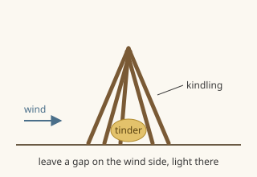

title: Making a fire
aka: fire, make fire, start a fire, campfire, tinder, kindling, firewood
tags: fire warmth cooking
warn: Never make a fire inside a tent, closed shelter or room without a chimney. Never leave a fire unattended.
see: carbon-monoxide, shelter
source: compiled from general survival references, verify before relying on it

A fire needs three things: heat, fuel and air. Most failed fires lack enough small, dry fuel at the start.

## how
1. Gather everything before lighting. Collect about three times what you think you need.
2. Tinder: things that catch a spark or flame. Dry grass, birch bark (burns even when damp), dry pine needles, cattail fluff, wood shavings, cotton.
3. Kindling: dead, dry twigs from pencil-thin to thumb-thick. Take dead branches still attached to trees: they are drier than wood on the ground. They should snap cleanly.
4. Fuel: wrist-thick wood and bigger.
5. Clear a spot about 1 m around, down to bare earth or stones, away from overhanging branches.
6. Put a loose ball of tinder in the middle. Lean kindling around it like a cone, leaving a gap facing the wind.
7. Light the tinder from the windward side. Blow gently at the base.
8. Add bigger pieces only once the kindling burns well.



```
            /\
           /  \        kindling leaning
          / /\ \       together like a cone
         / /  \ \
        / / ** \ \     ** = tinder ball
       /_/__**__\_\
   wind -> [gap]       light here, on the wind side
```

## safety
To put a fire out: drown it with water, stir the ashes, drown again, and touch to check it is cold. Earth or sand also works. Keep water or sand nearby while it burns.

## use
Fire gives warmth, boils water, cooks food, dries clothes, keeps animals away and signals for help.
